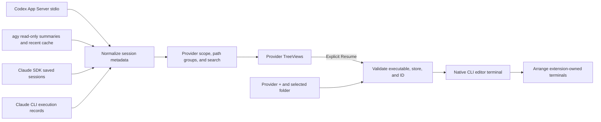

# Architecture and source map

## Responsibilities and data flow

The extension reads local provider metadata into separate TreeViews and forwards explicit user actions to native CLIs in editor terminals. It does not implement model requests or its own conversation store.

## Modules

| File | Responsibility |
|---|---|
| `src/extension.ts` | Commands, per-provider query lifecycle/cancellation, user settings, scope changes |
| `src/codex.ts` | Stdio JSON-RPC, handshake, request correlation, page normalization |
| `src/model.ts` | Provider/store/ID identity, Windows paths, scope comparisons |
| `src/sessionsView.ts` | Path parents and session children, status/errors, pagination, search |
| `src/externalCatalog.ts` | Merge Claude saved/live records; manage workers and CLI queries |
| `src/agyCatalog.ts` | Read agy summary databases and recent-session cache metadata |
| `src/catalogWorker.ts` | Run external catalog discovery in a cancellable worker |
| `src/runtime.ts` | Shared execution guards/environment cleanup; Codex executable/store validation |
| `src/agyRuntime.ts` | agy executable/contract validation and Resume source checks |
| `src/newSession.ts` | New interactive arguments and native runtime validation for each provider |
| `src/resumeTerminal.ts` | Safe CLI arguments/environment, saved-session reuse, new CLI launch |
| `src/editorTerminals.ts` | Serialized creation, movement, and close-triggered layout of owned terminals |
| `src/providerAppearance.ts`, `media/` | Provider icons for light/dark themes |
| `scripts/build-worker.cjs` | Bundle the catalog worker/SDK and preserve the upstream README |

Treat source as authoritative for implementation details. `dist/` is generated and must not be edited directly. Pending launches recheck configuration/disposal epochs, list identity, and Trust until final terminal creation. Foreign editor terminals and different terminal objects with duplicate names block layout merging. Close handling waits for delayed editor-tab removal.

## Discovery contracts

Codex uses a local native executable's `app-server` over stdio JSON-RPC. After the initialize response and initialized notification, the client requests `thread/list` with `useStateDbOnly=true`, non-archived records, explicit source kinds, and pagination cursors. Discovery does not probe `thread/resume` or `turn/start`.

Claude merges official Agent SDK `listSessions` metadata with native `agents --json --all` execution records. A successful source survives failure of the other. Discovery does not use SDK query/model APIs.

agy reads CLI/app/IDE summaries through read-only SQLite and merges path evidence from the CLI recent cache. It does not scan conversation bodies for listing/search. Unsupported schemas produce warnings. Records without source paths remain in an unknown-path group in all-local scope. Read-only SQL access does not imply that SQLite WAL/SHM sidecars remain unchanged.

Identity combines provider, store namespace, and native ID to distinguish overlapping IDs. Source, status, and compatibility remain separate. Discovery-server `notLoaded` and provider execution records do not establish global live state across other applications.

## Paths and pagination

Windows paths normalize drive/UNC forms, case, and separators. Descendant checks include directory boundaries so `project` does not include `project-other`. Multi-path sessions show only matching paths in the current scope while retaining the original Resume cwd.

Codex's exact-workspace and descendant filters differ: descendants require local filtering of DB metadata pages. Raw cursor state is separate from visible results. A load yields after 50 new matches or 20 pages; subsequent loads continue up to a 10,000-record scan cap. Malformed and duplicate rows count toward that cap. Individual malformed records are skipped with a count; invalid response structures and repeated cursors remain errors.

Per-provider generation counters and AbortSignals discard results arriving after cancellation, settings changes, or a newer query. One provider's failure does not clear another provider's list. Workers/subprocesses have timeouts and response-size limits. Hidden scoped views invalidate on workspace changes and reload when visible.

## Execution and layout

Executable, arguments, cwd, and environment are validated separately. Discovery uses `shell:false`; interactive execution uses Windows PowerShell with no profile and an EncodedCommand. ASCII/smart single quotes are escaped, control characters are rejected, and titles/previews never enter commands. Host-internal environment variables are removed while user settings and required CLI integration values are preserved. `TERM=xterm-256color` advertises terminal capabilities; the shell stays open after CLI exit so errors remain visible.

New sessions start from user folder selection. The extension does not append a saved ID, Resume option, model prompt, or approval bypass. The native CLI handles authentication, folder trust, interaction, and persistence. Launching a terminal and saving a session are separate outcomes.

EditorTerminals tracks owned Terminal objects and serializes create/close/move operations. Before moving, it verifies activeTerminal, a unique label, TabInputTerminal, and the activeTab reference. `setEditorLayout` and `moveActiveEditor` move existing processes; copy/split is not used to duplicate processes.

At most nine terminals are managed in the current activation. Recheck Trust/disposal/closure after awaits. Document tabs survive, but rebuilding the group layout may merge or rearrange document groups. Foreign terminals are not adopted by name.

## Security and support boundaries

Execution is limited to trusted, local Windows VS Code windows. Executable/data-root configuration is user/machine scoped. Do not directly modify provider DB/JSONL files or terminate other applications. Native CLI/App Server internal writes are not covered by a claim of read-only metadata access.

Product logs contain aggregates and sanitized failures. Fixtures are synthetic; do not store conversation screens, credentials, real IDs, or personal paths. Code checks, UI layout, native startup, history restoration, and final VSIX verification are separate evidence categories. Current results and plans are in [README](../README.md#current-status-and-validation).
